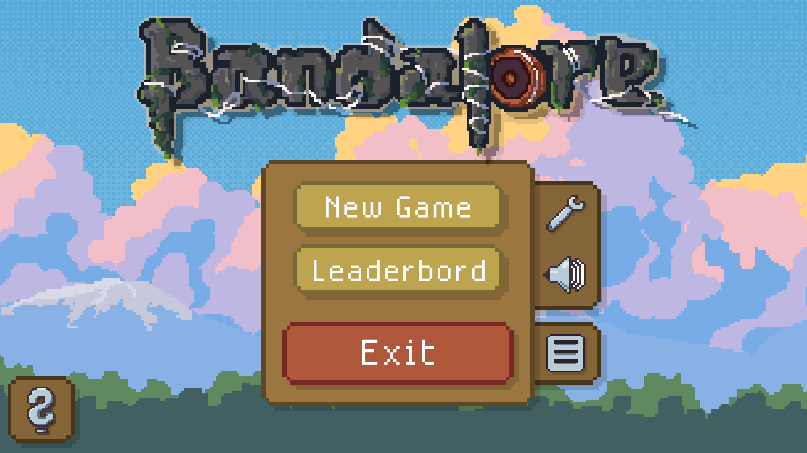
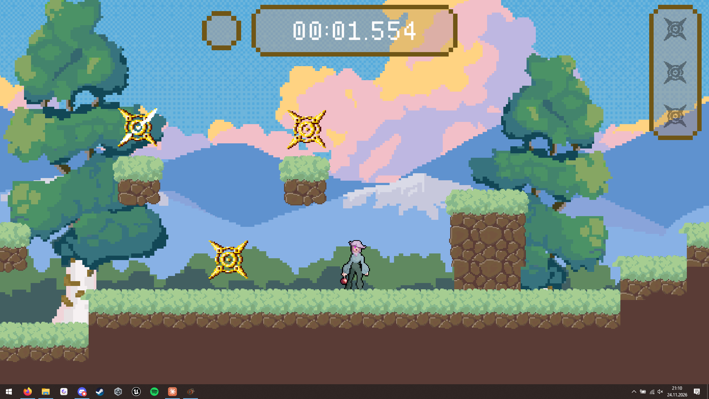
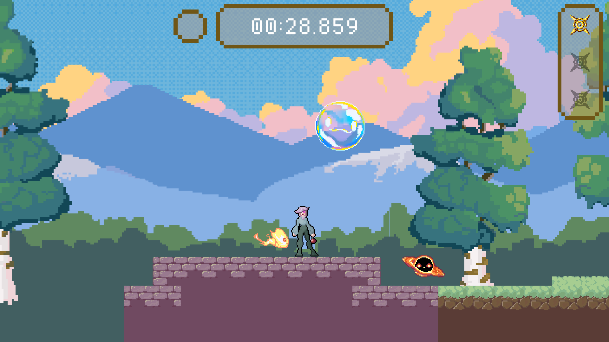

# Bandalore

**Ein Spiel Prototyp für Semesterprojekt 3 and der Hochschule Offenburg.**

## Über das Projekt

Dieser 2D Platformer soll ein Prototyp sein um die Grudsätze der Videospiel erstellung zu lernen. Dies war ein Projekt was im Rahmen des Semesterprojekt 3 Faches erstellet wurde in einem Team von 4 Mitglieder.

### Erstellt mit

- [Unity](https://unity.com)
- [Aseprite](https://aseprite.org/)
- [Audacity](https://www.audacityteam.org/)

## Screenshots und Demo Video

## Kontakt

- Luis Friesen – [LinkedIn](https://www.linkedin.com/in/luis-friesen-42346b298/) - Team Lead - Programmer
- Nils Hermes - [LinkedIn](https://www.linkedin.com/in/nils-hermes-530bb3418/) - Art Lead - Audio
- Satisha Eigenbrodt - [LinkedIn](https://www.linkedin.com/in/satisha-eigenbrodt-b93b98380/) - Art - Audio
- Mike Huck - Audio

- Projektlink: [https://github.com/ei5baer-0/Bandalore](https://github.com/ei5baer-0/Bandalore)
